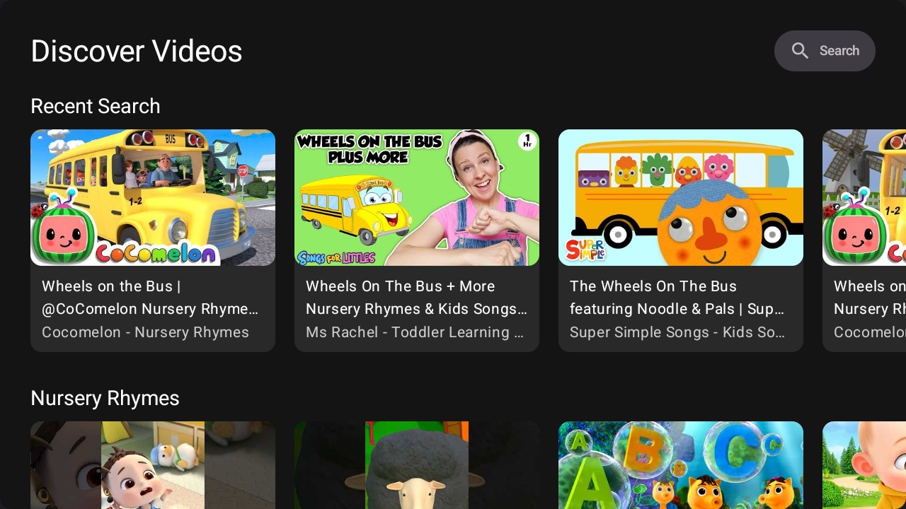
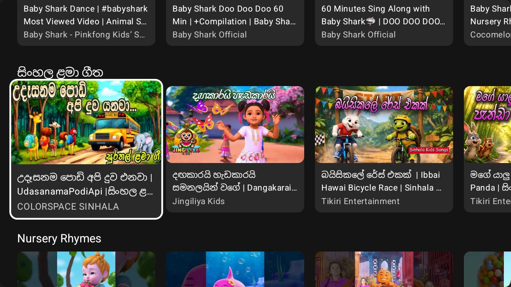
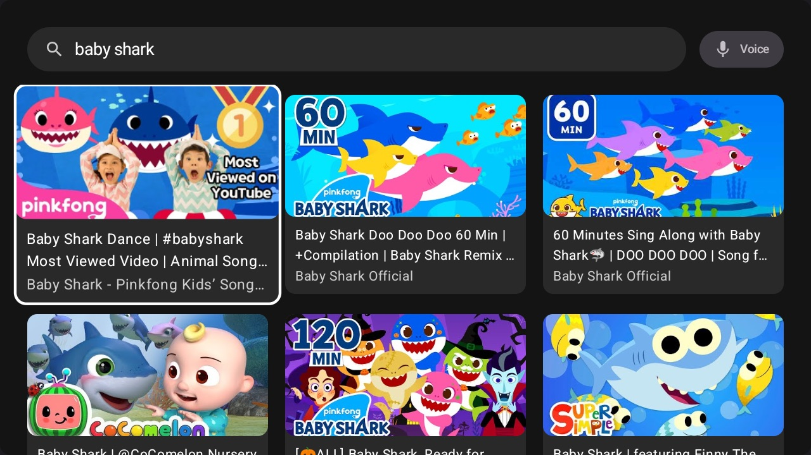
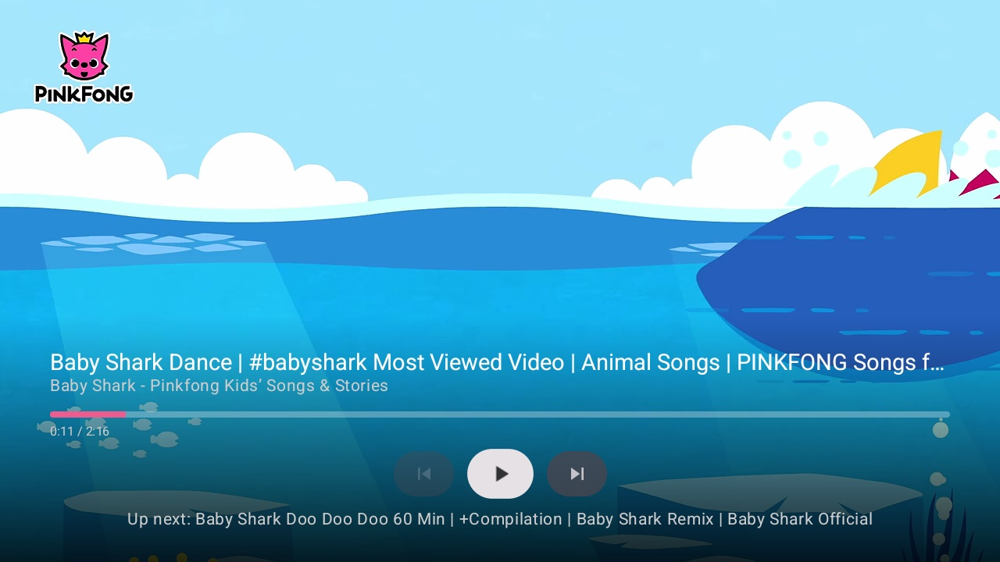
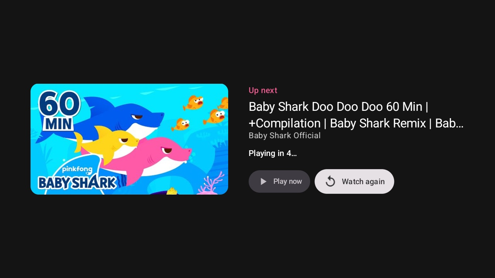

# BabyTube

A kid-safe YouTube app for **Android TV / Google TV**, built with Jetpack Compose for TV.
BabyTube shows only made-for-kids videos: nursery rhymes, lullabies, animal songs and more.
It's designed to be used with a TV remote and plays videos one after another, so babies can just watch.

<p align="center">
  
  
</p>
<p align="center">
  
  
  
</p>

## Features

**Browsing**
- Rows of **Nursery Rhymes**, **Lullabies**, **Animal Songs** and **ABC & Counting**.
- **New videos on every launch:** each row continues to the next page of results (it starts again after 5 pages).
- **Local-language row by country:** for example **සිංහල ළමා ගීත** (Sinhala kids songs) in Sri Lanka and Hindi in India.
- A **Recent Search** row that's always first once you've searched. It's stored on the device and costs no API quota.

**Search**
- **Text search** with the Google TV on-screen keyboard.
- **Voice search** through Google TV's own voice input, so the app needs no microphone permission.

**Playback**
- **Autoplay:** the rest of the row (or the search results) plays in order.
- BabyTube's own **"Up next" screen** with a 5-second countdown, so YouTube's suggested videos never appear.
- **Remote-friendly controls:** title, progress bar, and Previous / Play-Pause / Next buttons.
- After going back, **focus returns to the video that played last**.

| Remote key | Action |
|---|---|
| Select | Play / pause and show controls |
| Up / Down | Show controls |
| Left / Right | Seek −/+10 s (press repeatedly to skip further) |
| Back | Hide controls, then leave the player |
| Media keys | Play-pause / next / previous |

**Kid safety**
- Every search uses YouTube's `safeSearch=strict`.
- Every video is checked against YouTube's `madeForKids` and `embeddable` flags before it's shown, including in search results.
- YouTube's own player controls and end-screen suggestions are hidden. The remote can't reach YouTube links in the embedded player.

## Getting started

### Requirements
- Android Studio with AGP 9.4+, JDK 11+
- An Android TV / Google TV device or emulator running **Android 16 (API 36)** or newer
- A **YouTube Data API v3** key

### 1. Get a YouTube API key
1. Open the [Google Cloud Console](https://console.cloud.google.com) and create a project.
2. Go to **APIs & Services → Library**, find **YouTube Data API v3** and click **Enable**.
3. Go to **APIs & Services → Credentials → Create credentials → API key**.
4. Recommended: under **API restrictions**, restrict the key to *YouTube Data API v3*.

### 2. Add the key
Add this line to `local.properties` in the project root. That file is git-ignored, so never commit the key:

```properties
YOUTUBE_API_KEY=your_key_here
```

The key is exposed to the app as `BuildConfig.YOUTUBE_API_KEY` and sent in the `X-Goog-Api-Key` header, so it never appears in URLs or logs.

### 3. Build and run
```bash
./gradlew installDebug          # build and install on a connected TV / emulator
./gradlew testDebugUnitTest     # run the unit tests
```

## Architecture

BabyTube follows **Clean Architecture** in a single module, split into three layers:

```
presentation  ──►  domain  ◄──  data
(Compose UI,       (models,      (Ktor, DataStore,
 ViewModels)        use cases,    device info)
                    interfaces)
```

| Layer | Contents |
|---|---|
| `domain/` | Plain Kotlin with no Android code: `Video`, `VideoCategory`, repository interfaces, and the use cases `GetVideoRowsUseCase`, `SearchVideosUseCase` and `ObserveRecentSearchVideosUseCase`. Business rules live here, such as the category list, the country rows and saving recent searches. |
| `data/` | `YouTubeRemoteDataSource` (Ktor), `VideoRepositoryImpl` (paging and the kids-only filter), DataStore-backed page positions and recent searches, and `DeviceCountryRepository`. |
| `presentation/` | Compose for TV screens (`home`, `search`, `player`), ViewModels exposing `StateFlow` UI state, and Navigation 3 routes. |
| `di/` | Koin modules that connect each data implementation to its domain interface. |

How the videos are loaded: each row runs `search.list` (safe search, embeddable only, with a page token saved per category), then `videos.list` (title, thumbnail and made-for-kids status), and keeps only made-for-kids, embeddable videos.

### Tech stack

| | |
|---|---|
| UI | Jetpack Compose, Compose for TV (`tv-material` 1.0.0-alpha07) |
| Navigation | Navigation 3 (1.1.4) |
| DI | Koin 4.2 |
| Networking | Ktor Client 3.5 + kotlinx.serialization |
| Images | Coil 3 |
| Playback | [android-youtube-player](https://github.com/PierfrancescoSoffritti/android-youtube-player) 13 (official YouTube IFrame player) |
| Storage | DataStore Preferences |
| Testing | JUnit 4, kotlinx-coroutines-test, Ktor `MockEngine` |

## API quota

The YouTube Data API's default quota is **10,000 units per day per key**:
- Each row costs about 101 units (`search.list` = 100, `videos.list` = 1).
- A launch with 4–5 rows costs about 400–500 units.
- Each search costs about 101 units.

The quota is per **key**, not per user, so everyone using the same build shares it. Before a public release, consider caching results and serving them from a small backend.

## Known limitations

- On many Google TV devices the remote's mic/search button opens Google Assistant, not BabyTube. Use the in-app **Search** button.
- YouTube briefly shows the video title and logo when a video starts; the embedded player doesn't allow hiding them.
- Embedded YouTube videos may show ads, depending on the channel.

## License

No license has been chosen yet. All rights reserved.
